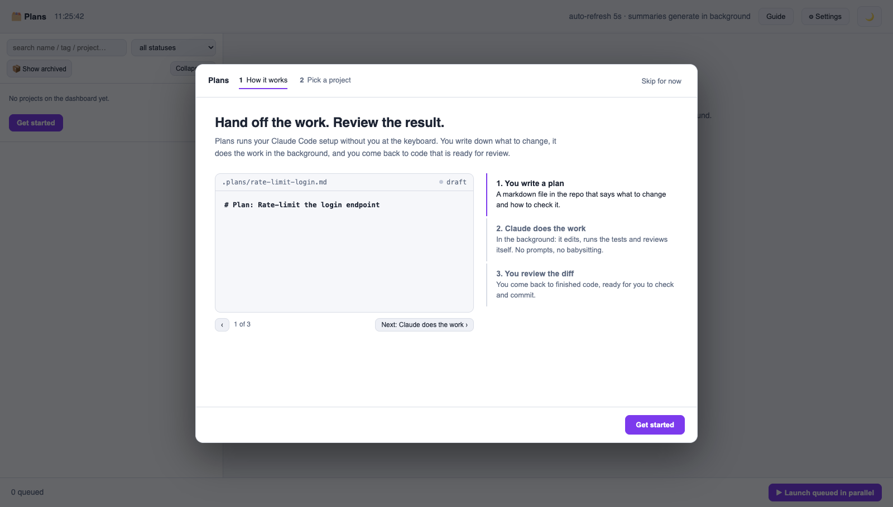
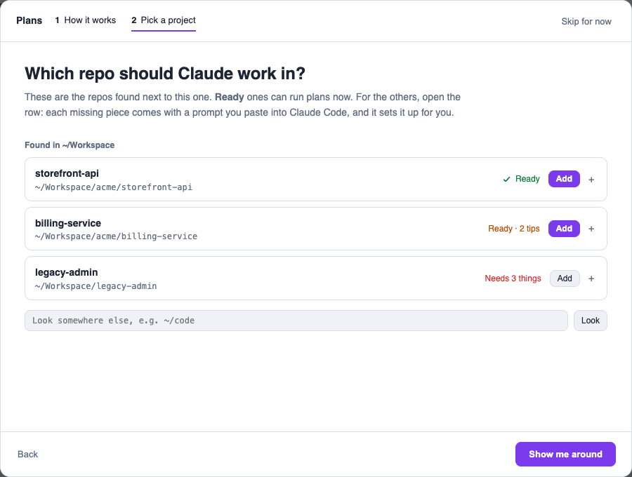
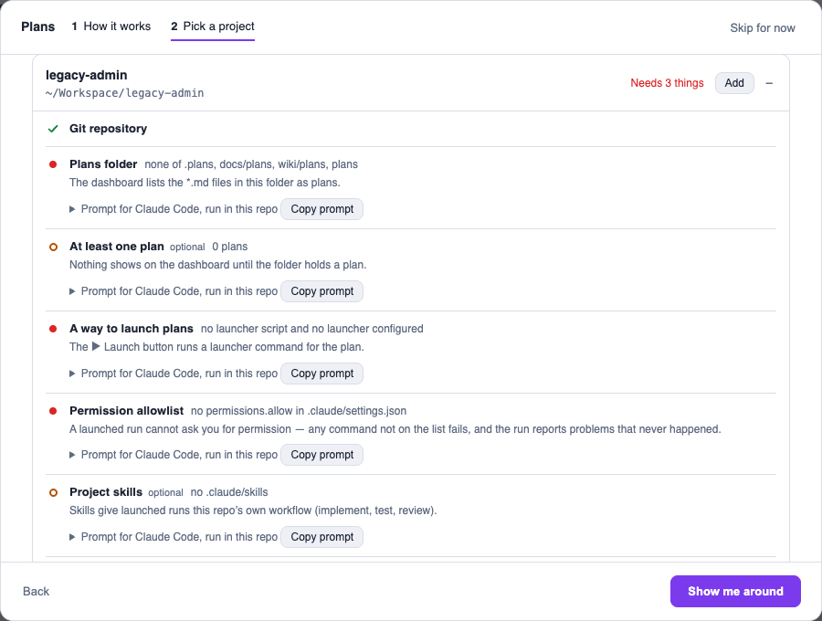
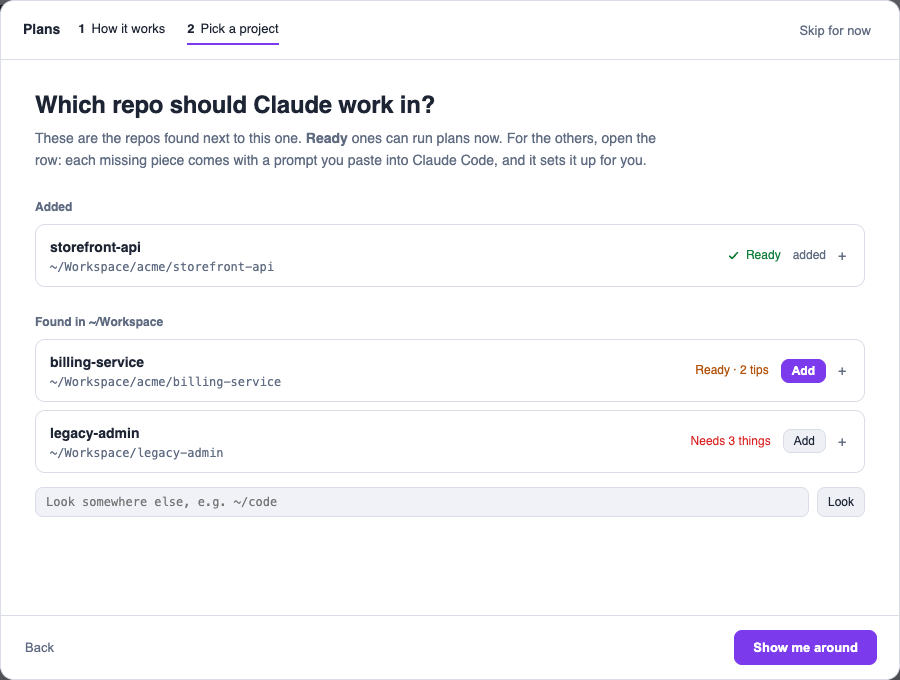
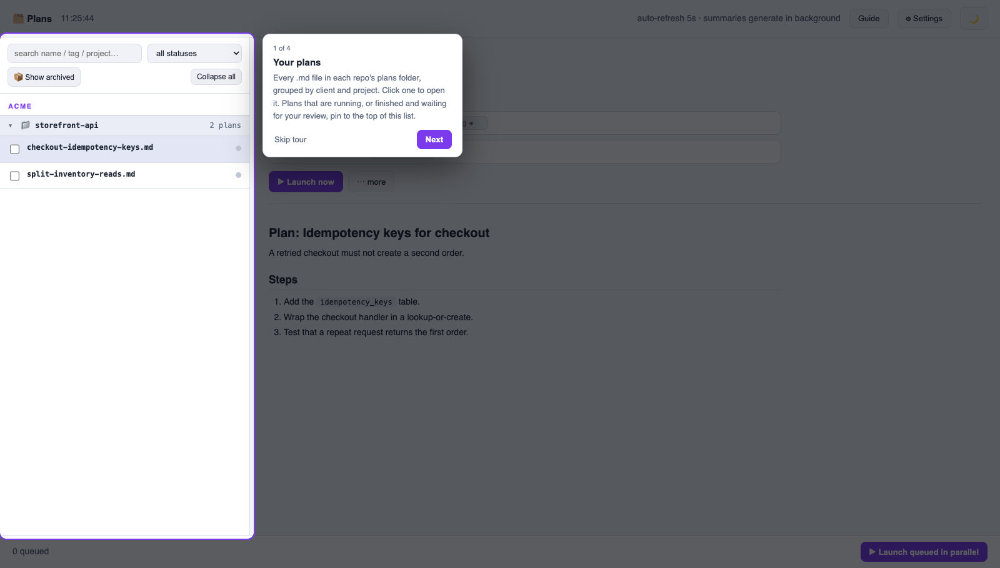

# Add a project to the dashboard

A project is a repository that the dashboard shows. You can add a project in three ways:

- **With the guide.** This is the recommended way. See the procedure below.
- **With Claude Code.** See [Add a project with Claude Code](#add-a-project-with-claude-code).
- **By hand.** Use the ⚙ Settings panel, or edit the file in [The registry](plans-dashboard.md#the-registry).

## Add a project with the guide

1. Open the guide. Use the line that applies to you:

   | Your situation | Do this |
   | --- | --- |
   | You installed the dashboard with `scripts/setup.sh` | Click **[https://plans.test/?guide=1](https://plans.test/?guide=1)** |
   | You did not install it | In the `claude-config` repository, run `node scripts/plans-dashboard.mjs`. Then click **[http://127.0.0.1:4899/?guide=1](http://127.0.0.1:4899/?guide=1)** |

   If you are not sure, click the first link. If the page does not open, use the second line. If you typed a different domain during the install, use that domain instead of `plans.test`.

   When the dashboard is already open, click **Guide** in the top bar.

   <picture>
     <source media="(prefers-color-scheme: dark)" srcset="add-project-1-guide-dark.png">
     
   </picture>

   Step 1 shows how a plan becomes a diff. Click **Get started**.

   If a tool is missing, step 1 also shows the tool and the command that installs it. Node, the `claude` CLI and git are necessary. jq is optional.

2. Find your repository in the list.

   <picture>
     <source media="(prefers-color-scheme: dark)" srcset="add-project-2-repos-dark.png">
     
   </picture>

   The guide looks for repositories in these folders, to a maximum of three levels deep:

   - the folder that contains the `claude-config` repository
   - `~/Workspace`, `~/Projects`, `~/code` and other usual development folders

   To look in a different folder, type its path in the field below the list. Then click **Look**.

   Each repository has a status:

   | Status | Meaning | Action |
   | --- | --- | --- |
   | **Ready** (green) | All items are in the repository. | Click **Add**. |
   | **Ready · N tips** (amber) | Plans can run. One or more recommended items are missing: a first plan, skills, `CLAUDE.md`, or the allowlist of a pipeline project. | Click **Add**. Fix the tips later. |
   | **Needs N things** (red) | A necessary item is missing: a git repository, a plans folder, a launcher, or the allowlist of a generic project. | Do step 3 first. |

3. If the status is not green, click the row. The row opens and shows each item.

   <picture>
     <source media="(prefers-color-scheme: dark)" srcset="add-project-3-fixes-dark.png">
     
   </picture>

   Each missing item shows why the dashboard needs it. To fix an item:

   1. Click **Copy prompt**. For some items, the button is **Copy**, and it copies a shell command.
   2. Open Claude Code in that repository.
   3. Paste the prompt and let Claude do the work.
   4. In the guide, click **Look** to check the repository again.

   To fix all items with one prompt, click **Copy one prompt that fixes all of it**.

4. Click **Add**. The repository moves to the **Added** list, and its plans show in the sidebar.

   <picture>
     <source media="(prefers-color-scheme: dark)" srcset="add-project-4-added-dark.png">
     
   </picture>

   If the repository has `.claude/scripts/run-skill.sh`, the dashboard uses that script as the launcher.

5. Click **Show me around**. A tour of four stops shows the parts of the screen: the plan list, the open plan, the launch bar, and the **Guide** and **Settings** buttons.

   <picture>
     <source media="(prefers-color-scheme: dark)" srcset="add-project-5-tour-dark.png">
     
   </picture>

> [!NOTE]
> If a registered project loses a necessary item later, the sidebar shows **needs setup** next to it. Open the guide to see the missing item and its fix.

## Add a project with Claude Code

1. Open Claude Code in the repository that you want to add.
2. Paste the prompt below.
3. Claude shows the proposed registry entry and the launcher command. Make sure that they are correct. Then tell Claude to continue.
4. Reload the dashboard. The project shows in the sidebar.

```
Register this repository with my plans dashboard.

The dashboard lives at ~/Workspace/claude-config (adjust if I cloned it
elsewhere). Read its docs/plans-dashboard.md, the header comment of
scripts/plans-dashboard.mjs, and scripts/pipeline-projects.example.json so you
know the registry format.

Then look at THIS repository and work out:

1. Which folder holds its plan files (*.md). Common spots are .plans,
   docs/plans, wiki/plans. If there is no such folder, say so and suggest one
   instead of creating it.
2. Whether .claude/scripts/auto-pipeline.sh exists. If it does, this is a
   "pipeline" project and needs no launcher. If not, it is a "generic" project
   and needs a launcher command.
3. For a generic project, one launcher command that would implement a plan in
   this repo. Base it on what this repo actually has — its .claude/skills, its
   .claude/scripts, its real test and build commands. Use {plan} where the plan
   file path goes. Prefer a small wrapper script under .claude/scripts over a
   bare `claude -p` command — copy scripts/launcher-template.sh from the
   dashboard repo and edit its two marked spots. See "How a plan gets launched"
   for why a headless run needs its permissions on the command line.

Show me the proposed registry entry and, in one plain sentence, what the
launcher command would run. Change nothing yet.

Once I approve, MERGE the entry into ~/.claude/pipeline-projects.json, keeping
every project already listed there. Create the file as {"projects": []} first if
it does not exist. Never drop or overwrite an existing entry.
```

*The screenshots show demo repositories, not real work.*
