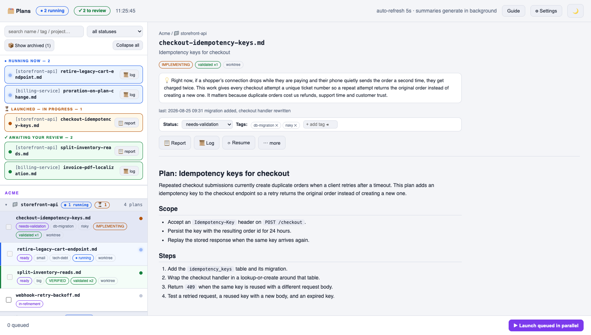
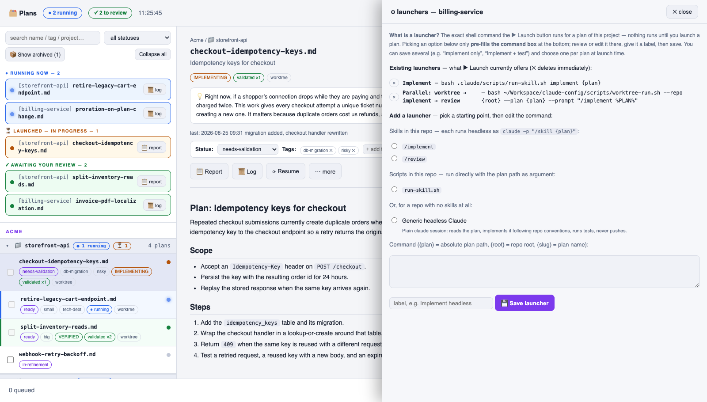

# Plans dashboard

A single-file, dependency-free Node server that lists the `*.md` plan files of every project you register, shows which ones have a run in progress, and launches them.

<picture>
  <source media="(prefers-color-scheme: dark)" srcset="plans-dashboard-dark.png">
  
</picture>

*Screenshots show a demo project set, not real work. To regenerate them after a UI change, run `node scripts/docs-media.mjs`, and add `--video` for the README's demo video.*

## Quick reference

| I want to… | How |
| --- | --- |
| Try it without installing | `node apps/dashboard/server.mjs` → http://127.0.0.1:4899 |
| Add a project | follow [Add a project to the dashboard](add-project.md) |
| Run it at login on https://plans.test | `scripts/setup-macos.sh` — see [Install](#install-it-to-run-at-login-macos) |
| **Apply my code changes to plans.test** | `npm run restart` in this repo — see [After editing](#after-editing-the-dashboard-code) |
| Read the logs | `~/.claude/pipeline-dashboard/server.log` |
| Run the tests | `npm test` |
| Uninstall | see [Uninstall](#uninstall) |

## Start it

```bash
# Start the dashboard, then open http://127.0.0.1:4899
node apps/dashboard/server.mjs

# Show the options and where the dashboard keeps its files
node apps/dashboard/server.mjs --help
```

Requires Node 18+ (developed on 24).

## Install it to run at login (macOS)

```bash
# Install the dashboard to run at login. It asks for a domain; press Enter to keep plans.test
scripts/setup-macos.sh
```

`scripts/setup.sh` runs this for you when you pick the dashboard part.

Then open **https://plans.test**. The script installs [Caddy](https://caddyserver.com) if missing, a launchd agent that keeps the dashboard running on `127.0.0.1:4899`, and a Caddy site that serves it over HTTPS and drops requests from other machines. It adds the domain to `/etc/hosts` and trusts Caddy's certificate (both ask for your password). HTTPS is what lets the browser use the clipboard and notifications; if Firefox still warns, set `security.enterprise_roots.enabled` in `about:config`.

Re-run it to change the domain or port, after switching Node versions with nvm (the agent stores Node's full path), or when the login service does not start after a `git pull` or a move of the repo (the agent stores the server's full path; `npm run restart` refuses and says so when that path does not exist). A re-run without `--port` keeps the port of the installed service; a re-run with unchanged settings leaves the running dashboard and Caddy alone. `npm run restart` waits for the port that the service uses.

## After editing the dashboard code

> [!IMPORTANT]
> plans.test does **not** pick up edits by itself. The agent runs `apps/dashboard/server.mjs` straight from this repo but reads it, and the page files in `apps/dashboard/page/` (`page.html`, `app.css`, `app.js`), only at startup. After every change, restart it:
>
> ```bash
> # Restart the dashboard so it loads your changes
> npm run restart
> ```
>
> It restarts the service (`launchctl kickstart -k gui/$(id -u)/com.plans-dashboard`) and checks that the server is back. Chats keep working through it: each chat's `claude` runs under `apps/dashboard/chat-relay.mjs` in its own process group, and the new server connects to it again and shows the turn that is running, including a pending permission question.

Then hard-refresh the page (Cmd+Shift+R). Nothing needs committing; the agent runs the working tree as it is. Plan runs and chats already in progress keep going through the restart. If the page does not come back, the reason (usually a syntax error) is in `~/.claude/pipeline-dashboard/server.log`.

## Logs

- Dashboard: `~/.claude/pipeline-dashboard/server.log`
- Caddy: `$(brew --prefix)/var/log/caddy.log`

## Uninstall

1. `launchctl bootout gui/$(id -u)/com.plans-dashboard`
2. `brew services stop caddy`
3. Delete `~/Library/LaunchAgents/com.plans-dashboard.plist`, the `import` line in `$(brew --prefix)/etc/Caddyfile`, and the domain's line in `/etc/hosts`.

## Add your first project

Follow [Add a project to the dashboard](add-project.md). It shows each step with a screenshot.

## The registry

Projects live in `~/.claude/pipeline-projects.json`. Copy [`scripts/pipeline-projects.example.json`](../scripts/pipeline-projects.example.json) as a starting point. Paths may start with `~`.

| Field | Required | Meaning |
| --- | --- | --- |
| `name` | yes | unique id; letters, digits, `.`, `_`, `-` |
| `root` | yes | repo root |
| `client` | no | grouping header in the sidebar (default `Default`) |
| `plansDir` | no | folder holding the `*.md` plans (default `<root>/.plans`) |
| `doneDir` | no | where archived plans move (default `<plansDir>/done`) |
| `launchers` | no | shell commands the ▶ Launch button can run — see below |

## How a plan gets launched

Two modes, picked automatically per project:

- **Pipeline** — the repo has `.claude/scripts/auto-pipeline.sh`. The dashboard delegates to it and reads back its reports, worktrees and lanes. It looks for a run's worktree in `<parent-of-repo>/worktrees/<repo-name>/<slug>`, then in the flat `<parent-of-repo>/worktrees/<slug>`, where older runs stay until they are cleaned up. Nothing to configure. The script can declare its own modes; see [Pipeline modes and run reports](#pipeline-modes-and-run-reports).
- **Generic** — everything else. You define one or more launcher commands; the dashboard runs the chosen one with `bash -lc` **in the repo root itself — no worktree** — captures its output, and tracks it to completion. A second run of the same plan is refused while one is live; two different plans launched at once would edit the same tree. `{plan}`, `{root}` and `{slug}` are substituted. The ⚙ setup dialog pre-fills commands from the repo's own `.claude/skills` and `.claude/scripts`.

> [!WARNING]
> A launcher that calls `claude -p` needs its tool permissions **on the command line**. Rules in `.claude/settings.json` are not honoured in a headless session, and a denied call is not a pause — it fails, and the run reports problems that never happened (`git status` "failed", a test suite "missing").

The fix that keeps one source of truth is a wrapper script that reads the repo's own allowlist and replays it onto `--allowedTools`, so interactive and launched runs get the same rules from the same file. [`scripts/launcher-template.sh`](../scripts/launcher-template.sh) is that script with two spots to edit — copy it to `.claude/scripts/run-skill.sh` in the repo being registered.

<picture>
  <source media="(prefers-color-scheme: dark)" srcset="plans-dashboard-launchers-dark.png">
  
</picture>

### Pipeline modes and run reports

By default, a pipeline project gets two "Where to stop" modes: `--stop-at-verify` and `--full`. A script can offer its own modes instead. When `auto-pipeline.sh` has a `--describe)` case, the dashboard runs it once (and again after the script changes) and expects JSON:

```json
{ "default": "verify",
  "modes": [
  { "id": "verify", "flag": "--stop-at-verify", "label": "stop at verify — I review by hand" },
  { "id": "commit", "flag": "--full",           "label": "full — through local commit" },
  { "id": "pr",     "flag": "--to-pr",          "label": "to PR — draft PR with a decision sheet" } ] }
```

The dashboard shows one radio button per mode. ▶ Launch runs `auto-pipeline.sh <flag> <plan>.md`. ⟳ Resume runs `--resume <slug> <flag>` in the mode the run was launched with: the report's `- **Mode**: <id>` line preselects that mode.

A launch fails when the script exits non-zero, or when it prints a line that starts with `SKIP:` and names the plan (`<slug>` or `<slug>.md`) as a whole word. Then the plan shows "⚠ didn't start", and "⚠ Why it didn't start" shows the `SKIP:` line or the script's last output.

`default` is optional and names the mode a new plan starts on; without it, the first mode. The dashboard also remembers the last mode you picked for each project, in this browser, and that pick wins over the default.

The report `<plansDir>/auto-runs/<slug>.md` can contain these lines:

| Line | Effect |
| --- | --- |
| `## Status: <text>` | Shown as is. |
| `- **Outcome**: running \| needs-you \| failed` | Puts the run in "in progress", "✓ waiting on you" or the failed state. It must be correct when no session runs; while one runs, the dashboard shows "● running now" and ignores it. A `failed` whose status no longer starts with `BLOCKED`, `FAILED` or `ENDED` is stale (a chat fixed the run after the launcher wrote it), and the status words decide. Without this line, the dashboard uses the status words: `VERIFIED`, `REVIEWED`, `COMMITTED`, `FINISHED` and `PR OPEN` mean needs-you; `BLOCKED`, `FAILED` and `ENDED` mean failed. |
| `- **Link**: <label> \| <url>` | One button per line (up to 5) in the "waiting on you" strip and in the plan view, for example `- **Link**: Open PR \| https://github.com/…/pull/42`. |

A generic launcher can write the same lines. The dashboard passes the file path in `$PLAN_REPORT` and clears the file before each run. When the process has ended, an `Outcome` of `needs-you` or `failed` wins, together with the report's `Status`. Otherwise, the exit code decides as before: 0 means "waiting on you", anything else means failed. `Mode` has no effect for launchers. Example, at the end of `run-skill.sh`:

```bash
echo "## Status: PR OPEN — 2 DECISIONS WAITING" >> "$PLAN_REPORT"
echo "- **Outcome**: needs-you" >> "$PLAN_REPORT"
echo "- **Link**: Open PR | $pr_url" >> "$PLAN_REPORT"
```

For a pipeline project without `--describe`, the setup guide shows a tip with a prompt that adds it.

Generic run state (pid, exit code, log) lives under `~/.claude/pipeline-dashboard/`. Statuses and tags are written to `~/.claude/pipeline-dashboard/state/<project>/plan-meta.json` for every project, never into the repo.

## Board

**▦ Board** in the header shows every plan of every project on one board, one column per stage. The sidebar hides while the board is open: the board has its own search box, filters and **▶ Launch queued**. Click a card to open its plan in a panel on the right; the board stays in view, the next card click switches the panel, and **✕ Close plan** or Esc closes it. The link is `?view=board` (with `&sel=<plan>` while a plan is open).

| Column | A plan is here when (first match wins) |
|---|---|
| Done | its PR is merged, or the plan is archived |
| Proposed | its status is `proposed`: the [scout](scout.md) found it, and **✓ Confirm** or **✕ Dismiss** waits for you |
| Running | it starts, runs now, or was launched and is still in progress |
| Failed | it did not start, or the run stopped blocked or failed |
| Needs you | the run waits for your review, or the chat asks for a permission |
| Ready | it has at least one validation round (or status `ready`), and its status is not `in-refinement`, `waiting-on-external` or `parked` |
| Backlog | anything else |

Every column fills in by itself. Tick **queue** on a Ready card and use **▶ Launch queued**. The filters narrow the board by client or project and by tag. Done shows plans from the last 14 days (by merge date, else by the date in the file name), the newest 40; **older archived** adds the rest.

## Tabs and keyboard shortcuts

Each plan or worktree you open becomes a tab in the strip under the header. You open it from the sidebar, the run strip, a board card, an alert, a link or the palette. Click a tab to open its plan, and **×** to close the tab.
A plan you open from the sidebar, a board card or the drawer goes into the preview tab (its title is in italics). The next plan you open that way takes its place, so you can look through plans without making a tab for each one. Double-click the row, click the preview tab, or send a chat message in it, to keep it as a normal tab. The box on a row (not a double-click) queues the plan for ▶ Launch queued.
A tab shows the project label, the PR number, the plan title and a status word: working, asks you, your turn, failed, answered, merged or idle. A chat whose turn ended while a background agent or shell still runs counts as working; the chat says "waiting for a background task…" until it ends. The tab strip sits above the plan, right of the sidebar.
When the open plan's PR is merged, a card on the right says so. **🧹 Clean up worktree and branch** runs the project's `auto-pipeline.sh --cleanup <slug>` (the run report stays; it refuses when the worktree has changes that are not committed). **Okay, close** closes the card and the tab; the card does not come back for that plan. The card shows for a merge of the last 7 days, or while the worktree is still on disk. Closing a tab never stops an agent or a run: the plan stays in the sidebar and in the run strip. Esc closes the open plan, and its tab stays.

| Key | What it does |
|---|---|
| Ctrl+1 … Ctrl+8 | Open tab 1 … 8 |
| Ctrl+9 | Open the last tab |
| Ctrl+W | Close the open tab; the tab to its right opens (else the one to its left) |
| Ctrl+Shift+T | Open the last closed tab again |
| ⌘K (macOS), Ctrl+K (other systems) | Open the palette: find a plan or a worktree (by title, file, project, `#<PR number>` or a pasted GitHub PR link), or run a header action (Board, Scout, Settings, Add project, Chat, Plan tab, Files changed, Close tab, Reopen closed tab, Theme, Alerts). A row shows the project, the PR tag (`PR #283 · open`), the title and the status word. |
| Arrow Up / Arrow Down, Enter | In the palette: pick a row, run it |
| Esc | In the palette: close it; the focus goes back where it was |

The tabs are kept in this browser (`localStorage` key `dash-tabs`). A tab goes away when its plan is gone from a project that the dashboard still shows. The closed-tab list is kept only until the page reloads.

The page gives the Mac app its hooks in `window.dashboard`: `switchSession(n)`, `nextSession(d)`, `closeSession()`, `reopenSession()` and `openSearch()`.

Known limits:

- ⌘K inside the Files changed diff editor opens the palette.
- Two browser windows share one `dash-tabs` list; the last change wins.
- Back or Forward to a closed plan opens it as a tab again.
- macOS can take Ctrl+1 … Ctrl+9 when "Switch to Desktop N" is on (System Settings → Keyboard → Keyboard Shortcuts → Mission Control).
- On Windows and Linux the browser keeps Ctrl+1 … Ctrl+8, Ctrl+W and Ctrl+Shift+T for itself. There, use Ctrl+K and clicks.

## Alerts

**🔔** in the header turns on a short sound when a run stops (needs you, failed or finished) the chat agent finishes an answer, or the chat agent asks for permission. When the dashboard tab is not in front, a desktop notification comes too; clicking it opens that plan. The browser asks once for permission to show notifications. The setting is remembered in this browser, and alerts need the dashboard open in a tab (a background tab can be up to a minute late).

The dashboard server also sends macOS notifications, with no page open: when it starts a plan by itself, when such a start fails, when a `Waits for:` line has an error that you must fix, and when a run of a pipeline project (with `.claude/scripts/auto-pipeline.sh`) needs you or failed. A notification reads like a tab: the title has the project label, what happened and the PR number (`acme-web · your turn · PR #903`), the line under it has the plan title, and the text has the detail without links. A click opens that plan; this needs `terminal-notifier` (`brew install terminal-notifier`), because an `osascript` notification opens Script Editor. With 🔔 on and the page open, a run that stops gives two notifications: one from the page and one from the server. `DASH_NO_NOTIFY=1` turns the server's notifications off.

## Pull requests

When a plan's branch `auto/<slug>` has a PR on GitHub, the plan shows a `PR #n` chip, and its panel gets two more tabs. The [chat](#chat-with-the-agent) opens beside both. The plan tab itself opens on the summary and the buttons; status, tags and session history are under **⋯ more**, and the plan text is under **Show the full plan**. **Open PR** opens the Pull request tab.

The PR's state, **↗ GitHub** and the next step (**Ready for review** for a draft, **Merge…** after that) sit at the right end of the tab row; the plan tab has **↗ GitHub** next to **Open PR**. **Files changed** opens in review mode: the plan list and the page header are hidden, and one bar holds **‹ Plan** (or Esc), the plan name, the tabs and that next step. The address bar keeps the open plan, tab and file, so a reload reopens them and Back goes to the previous plan or tab.

- **Pull request**: the plan's 💡 summary, then the PR's title, branches, size, a merge box, and the description as formatted text. The merge box lists what GitHub checks before a merge (draft, CI checks, review, conflicts). A draft or a PR with conflicts cannot be merged here. When the base branch has commits that the PR does not have (GitHub's compare API), or GitHub reports conflicts, the chat shows **Fix conflicts** next to **Compact**. A click sends `/merge-parent <base>` to the chat: the agent merges the base branch into the worktree's branch, resolves the conflicts, runs the checks and pushes. Failed checks and a missing review are shown as warnings. When GitHub itself blocks the merge (a branch rule, such as a required approval), the box says so; a repo admin can tick **Merge as admin** (`gh pr merge --admin`). When GitHub refuses an action, its message shows at the top of the tab. **Merge into <base>** uses the methods the repo allows (your last choice is remembered), can delete the branch on GitHub, and merges only the commit you reviewed (`--match-head-commit`). After the merge, the dashboard runs `git pull --ff-only` in the repo's main checkout, never in the worktree, and only when that checkout is on the PR's base branch; the merged plan then shows in `done/`. When that pull cannot run (for example, the local branch has commits that GitHub does not have), the page shows a warning and a red line that tell you to pull by hand. With 🔔 on, a sound also plays, and a desktop notification comes when the tab is not in front. To pull without a merge, click **📥 Pull** on the project header: it runs the same `git pull --ff-only` in the main checkout, on the branch it is on, from that branch's remote. **Back to draft** and **Close PR** are under **⋯**. A description checkbox writes the change back to GitHub, the same as ticking it on github.com. If the description changed on GitHub since the page loaded it, the tick is refused and the page loads the description again.
- **Files changed**: the changed files as a folder tree, and the diff of one file at a time in VS Code's diff view (Monaco, the editor inside VS Code, loaded from cdn.jsdelivr.net the first time): syntax colours, changed words marked inside a line, a minimap and change marks on the right, and a divider between the sides that drags. **Whole file** shows the whole file (read at the PR's latest commit with `gh api`; the old side is rebuilt from it and the diff), **Changes only** folds the unchanged parts, as VS Code does. A file opens at its first change. Without internet the page falls back to a plain diff table with its own change strip and divider. A file you mark as viewed is remembered in this browser until its diff changes. **⚑ Recheck** (in the diff header, on a file row, or F in the tree) marks a file to come back to; a file is either viewed or to recheck, and the bar counts both. A folder's box marks every file in it. In the tree, ↑/↓ move, Enter opens, Space marks a file viewed, F marks it to recheck. Drag the file list's right edge to resize it (double-click puts it back); this browser remembers it.

Everything goes through the `gh` CLI, so it must be installed and logged in. The guide's first step shows a **GitHub CLI** row with the fix when it is not, and a plan in a GitHub repo says why its PRs are not shown. The dashboard checks the list of PRs at most once a minute per project; **⟳** in the PR bar reads the PR, its checks and its diff again right away (for example after a push). PRs on other branches (for example, a PR that you opened by hand) are not shown.

## Upgrade the scaffolding

When the bootstrap-project templates or a project's answers changed since the last apply, the project header of a GitHub repo shows **bootstrap update ▶** (a repo with no GitHub origin shows **bootstrap update**, which copies the `/bootstrap-project --upgrade` prompt). A click starts `skills/bootstrap-project/scripts/upgrade-run.mjs <repo>` in the background, with no chat. The chip then says **upgrading…**.

The run makes the worktree `../worktrees/<repo>/bootstrap-upgrade-<hash>` on the branch `auto/bootstrap-upgrade-<hash>` from `origin/<base>`. A headless Claude session decides merge, keep or replace for each changed file, in a temp run folder only. The script writes the files, runs `verify.mjs`, makes one commit, pushes the branch and opens a draft PR. The chip then says **upgrade PR #n** and opens the PR. The PR body lists each file, and the items only you can decide as checkboxes.

When a run fails, the chip says **upgrade failed** (hover it for the reason). A click starts again: a failure before the commit leaves nothing behind, and a failure after it continues from the push or the PR. When you closed the upgrade PR on purpose, the run stops and names the commands that delete its branch; after them, a click starts again. A run that was stopped while it wrote the files (for example a restart of the Mac) leaves uncommitted files in its worktree: the next click stops and names the worktree. Look at it, then run `git worktree remove --force <worktree>`. After the merge on GitHub, the chip says **upgrade merged — pull** until you pull the main checkout. When the templates change while an upgrade PR is open, the next run opens a new PR whose body asks you to close the older one.

After the merge, run `git pull`, then `bash .claude/scripts/auto-pipeline.sh --cleanup bootstrap-upgrade-<hash>`. When it cannot delete the branch after a squash merge, run `git branch -D auto/bootstrap-upgrade-<hash>`. The log is `.plans/auto-runs/bootstrap-upgrade.log` in the repo, and the status is `.plans/auto-runs/bootstrap-upgrade.json`.

## Chat with the agent

**💬 Chat** (next to the tabs) opens a chat panel on the right of Files changed and the plan. It works like the Claude Code panel in VS Code. The panel talks to the Claude session that ran the plan, in the plan's own folder (its worktree, or the repo root for a generic project), so the agent has its whole history: the plan, the files it read and what it decided. Ask why it did something, or tell it to do something, for example "merge develop into this branch". The panel stays open when you change files or tabs. Drag its left edge to resize it (double-click puts it back). This browser remembers whether it is open and how wide it is.

- **Sidebar status**: the plan's row in the sidebar (and in the strips at the top) shows what its chat is doing: `💬 working…` while the agent works, `🔐 asks you` while it waits for a permission answer, and `💬 answered` when it finished while that chat was not open. `answered` stays until you open that plan's chat; this browser remembers it across reloads.
- **History**: the panel shows the session's transcript: the run first, then the chat. Each tool call is one line (for example `Edit src/x.ts`); click it to see its input and result. A subagent's report is one line with its title (for example `Subagent report: Test review`); click it to read the report. Older messages load when you scroll up.
- **Live session**: the first message starts one `claude -p` that stays open (`--input-format stream-json`, the protocol the VS Code extension uses). The answer appears word by word, already formatted as Markdown. **Stop** ends the turn. A message sent while the agent works is queued. After 15 minutes without a message the session closes; the next message opens it again. Starting a run in that plan closes the chat first. A chat cannot start while a run works in that folder.
- **Permissions**: when the agent needs permission, a card shows the command or file with **Allow**, **Allow for this chat** (that rule, for this session only; nothing is written to the repo's settings) and **Deny**. An edit card offers **Allow all edits in this chat** instead: the session switches to Edit automatically until it closes. To tell the agent what to do instead, type it in the box and click **Deny**. In Plan mode, the agent's plan appears in a card to approve. The mode picker sets what the agent may do without asking: **Ask before edits**, **Edit automatically**, **Plan mode** or **Auto** (Shift+Tab in the box switches). It applies right away, also during an answer.
- **Selected lines**: lines you select in the diff (either side) or text you select in the plan show as a chip above the box and go with the next message, in the same form the VS Code extension sends them. ✕ leaves them out.
- **/ and @**: `/` lists the skills and commands the session has in that folder; `@` lists the PR's changed files. ↑/↓ choose, Enter or Tab inserts.
- **Model**: the model picker lists the models your account has; it applies to the open session right away.
- **Context size**: a meter beside the pickers shows how full the session's context is, for example `41% of 1M` (hover for the exact tokens). It turns yellow at 70% and red at 90%. **Compact** runs `/compact`: the earlier conversation is replaced with a summary. It is disabled while the agent works, and your draft and selected lines stay in the box.
- **Fork**: the next message continues in a copy of the session (`--fork-session`). The session the run wrote then keeps only what the run did. **New chat** (shown while the chat is in a copy) starts again from the run's latest session.

The current chat's session is kept in `~/.claude/pipeline-dashboard/state/<project>/ask/<slug>.json`.

## AI session history

A plan's panel lists the Claude sessions that belong to that plan, with copy-ready commands to resume the latest one, or to hand a fresh reviewer the diff and the transcript to cross-check.

For generic projects the sessions are read out of the plan's own captured log, so the panel lists **only runs launched from the dashboard**, and only that plan's. Two consequences worth knowing: a launcher that does not emit `--output-format stream-json` leaves no session ids behind and the panel stays empty; and sessions you ran by hand in that repo never appear, because claude stores transcripts per working directory and nothing records which plan one was about. Pipeline projects give each plan its own worktree, so their transcript folder is already plan-specific and is listed whole.

## Running several plans at once

Generic launchers run in the repo root, so two plans launched together would edit the same files. [`scripts/worktree-run.sh`](../scripts/worktree-run.sh) gives each plan its own git worktree and branch, which is what makes a batch safe: tick several plans, hit ▶, and each one gets an isolated tree.

Point the project's launcher at it and the dashboard needs no other change:

```json
{
  "label": "Parallel: worktree → implement → review",
  "cmd": "bash ~/Workspace/claude-config/scripts/worktree-run.sh --repo {root} --plan {plan} --prompt \"/implement %PLAN%\""
}
```

> [!WARNING]
> Use `%PLAN%` inside `--prompt`, not `{plan}` — the dashboard substitutes `{plan}` in the command before the script ever runs.

Per plan it creates `<parent-of-repo>/worktrees/<slug>` on branch `auto/<slug>`, forked from the repo's **current** branch (`--base` overrides), initialises submodules, copies gitignored local files in (`--copy`, default `.env` — often the credentials a private package feed needs), marks the new path trusted in `~/.claude.json` so the headless run honours your allowlist, runs `--setup` if the repo needs an install step, then runs two phases: your prompt, then `/code-review high --fix` with a re-test (`--review none` to skip). The work is left uncommitted in the worktree for you to review.

> [!IMPORTANT]
> **A worktree is a checkout of the base branch, not a copy of your working tree.** Anything the run needs — the plan, and every skill the prompt invokes — must be committed there first. The script checks both and refuses rather than launching a run that fails confusingly.

Clean up after merging:

```bash
# Remove the plan's worktree and its branch
scripts/worktree-run.sh --repo <repo> --cleanup <slug>
```

It deinitialises submodules first (they block `git worktree remove`) and refuses to discard uncommitted work or delete an unmerged branch.

## Waits for and the event watcher

The dashboard server checks every project once a minute, also when no page is open. It reads the PRs on GitHub and the run reports, writes what changed as events, and starts a plan when the condition of its `- **Waits for**:` line becomes true.

Write one or more `- **Waits for**:` lines in the plan header (the lines before the first `## ` heading, outside code blocks). A line in the body, or in a code block, is only an example and does nothing. All lines must be true. The three conditions:

| Condition | True when |
| --- | --- |
| `api PR #7 merged` | PR #7 of the project `api` is merged. The project is a registry `name`, or a `short` that only one project has. The dashboard reads that PR directly. |
| `api plan 20261123-100000-contracts merged` | the newest PR on the branch of that plan of `api` is merged: the branch its `- **Branch**:` line names, else `auto/<slug>`. The dashboard looks in the newest 200 PRs of `api`. A slug with no plan file in `api` and no PR on `auto/<slug>` is the error "unknown plan". |
| `submodule contracts contains 1a2b3c4` | the submodule pointer at `contracts` on `origin/<base>` of this plan's own project contains commit `1a2b3c4` (7 to 40 hex characters). `<base>` is the plan's `- **Base**:` line. The submodule must be initialized in the main checkout. |

A `Waits for:` line is the owner's "go": when all its conditions are true, the dashboard starts the plan by itself in the project's "to PR" mode (`pr`), or in the project's default mode when the project has no such mode. Only pipeline projects (with `.claude/scripts/auto-pipeline.sh`) can start a plan by itself. While the plan waits, its row and its board card show `⏳ waits`; hover the chip to see each condition with ✓ or ✗ and the reason when a condition cannot be checked.

The dashboard does not start a plan by itself when:

- 4 plans of the project run already. A plan runs when its run is live, when it is starting, or when its report says it is running and changed in the last 30 minutes. A manual ▶ Launch counts toward the 4, but the dashboard never refuses it.
- the plan's chat is working, or it asks you for a permission. The start comes when the chat stops.
- its status is `parked` or `proposed`.
- it has a run, a run report or a worktree already.
- you launched it by hand and that launch failed (the plan shows "didn’t start"). The dashboard keeps that state until it restarts; launch the plan again from the page.

The dashboard starts a plan by itself only once. When that start fails (for example, the launcher prints `SKIP:`), the dashboard says why in an event and a notification, and does not try again: launch the plan again from the page. A plan that you archive and put back does not start again.

After a merge on GitHub, the dashboard runs `git pull --ff-only` in the main checkout of that repo, when the checkout is on the PR's base branch. It never pulls the dashboard's own repo: pull it and restart the dashboard by hand (see `AGENTS.md`). A PR that you merge with the dashboard's merge button is pulled by the button, not again by the watcher. A failed pull is not tried again: use **📥 Pull**. When a second dashboard with the same HOME merges a PR, two pulls can meet; the slower one then says "Pull by hand". Worktrees stay after a merge until you click **Clean up run**.

The dashboard reads at most 10 pages of 100 updated PRs per check. After a very long time with the dashboard off, older updates make no event. A PR merged before the dashboard first saw the project makes no event.

Events are written at most once: a crash can lose an event, but never repeats one or starts a plan twice. `GET /api/events?project=<name>&limit=<n>` gives `{ events: [...] }`, oldest first, the last `limit` (default 200, at most 1000). The events are in `~/.claude/pipeline-dashboard/state/<project>/events.jsonl` (the last 5000 lines):

| Type | Fields |
| --- | --- |
| `pr-opened`, `pr-closed` | `number`, `title`, `url`, `branch`, `base` |
| `pr-merged` | the same, and `pull`: what the pull did, or why there was no pull |
| `run-outcome` | `slug`, `outcome`, `status`, `previous` |
| `wait-met` | `slug`, `conditions` |
| `wait-error` | `slug`, `text`, `reason` |
| `auto-launch` | `slug`, `mode` |
| `auto-launch-failed` | `slug`, `output` |

Text that comes from a command (`gh`, `git`, the launcher) has its secrets removed and is cut to 500 characters.

Only one dashboard per HOME runs the watcher (`~/.claude/pipeline-dashboard/watcher.lock`). Another dashboard with the same HOME logs "another dashboard runs the watcher" and takes over when the first one stops. Start a test dashboard by hand with `DASH_WATCH_MS=0` when it uses your real HOME.

## Environment

| Variable | Effect |
| --- | --- |
| `DASH_PORT` | port to listen on (default `4899`) |
| `DASH_NO_OPEN=1` | do not open a browser at startup |
| `DASH_NO_SUMMARY=1` | do not generate plain-language plan summaries |
| `DASH_SUMMARY_MODEL` | model the `claude` CLI uses for summaries (default `haiku`; e.g. `claude-opus-5-5`) |
| `QA_REPORTS_PORT` | port of the read-only server for browser-usability-test report pages (default `4898`): `http://localhost:4898/<project>/<file>.html`, so a link in the VS Code chat opens them, and the list of all reports at `http://localhost:4898/` (**QA reports ↗** in the header). If you change it, set the same value where Claude runs, so the skill links the right port |
| `QA_HOME` | where those reports live (default `~/.claude/browser-usability-test/projects`). Each project folder has `reports/` (the skill's report pages) and `artifacts/` (single-file pages written by `node scripts/artifact-copies.mjs --save <page.html>`, and Claude artifacts downloaded from claude.ai); `_other/artifacts/` holds pages of no project. Saving a page again keeps its link and moves the old page to `.versions/<page>/v<n>.html` in the same folder; a version menu on the page opens it (`?v=<n>`) |
| `CLAUDE_TMP` | Claude Code's session temp folders (default `/private/tmp/claude-<uid>`); HTML in their scratchpads is listed as unpublished drafts |
| `DASH_WATCH_MS` | how often the [event watcher](#waits-for-and-the-event-watcher) runs, in milliseconds (default `60000`); `0` turns it off |
| `DASH_NO_NOTIFY=1` | the watcher sends no macOS notifications |
| `DASH_NOTIFIER` | the notifier program the watcher calls with `-title`, `-message`, `-open` and `-group` (default `terminal-notifier` when it is installed, else `osascript`) |

> [!WARNING]
> Summaries are produced by calling the `claude` CLI, which **sends plan text to the Anthropic API**. Set `DASH_NO_SUMMARY=1` for repos whose contents must not leave the machine.

Summaries are written in ASD-STE100 Simplified Technical English. If you change the summary prompt in `apps/dashboard/server.mjs`, increase `SUMMARY_STYLE` next to it. The dashboard then remakes every existing summary in the background.

## Tests

```bash
# Run all tests: the dashboard, the scout and the skills
npm test
```

They run against a throwaway `HOME` and a throwaway repo — the real registry is untouched.
