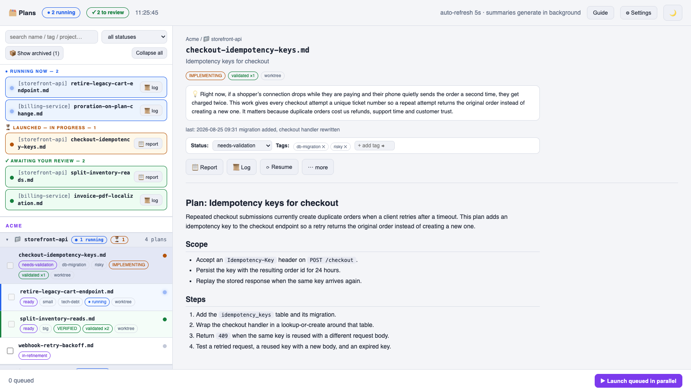
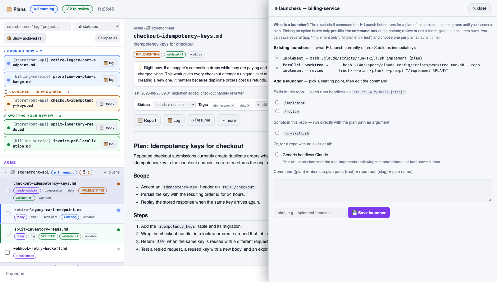

# Plans dashboard

A single-file, dependency-free Node server that lists the `*.md` plan files of every project you register, shows which ones have a run in progress, and launches them.

<picture>
  <source media="(prefers-color-scheme: dark)" srcset="plans-dashboard-dark.png">
  
</picture>

*Screenshots show a demo project set, not real work. To regenerate them after a UI change, run `node scripts/docs-media.mjs`, and add `--video` for the README's demo video.*

## Quick reference

| I want to… | How |
| --- | --- |
| Try it without installing | `node scripts/plans-dashboard.mjs` → http://127.0.0.1:4899 |
| Add a project | follow [Add a project to the dashboard](add-project.md) |
| Run it at login on https://plans.test | `scripts/setup-macos.sh` — see [Install](#install-it-to-run-at-login-macos) |
| **Apply my code changes to plans.test** | `launchctl kickstart -k gui/$(id -u)/com.plans-dashboard` — see [After editing](#after-editing-the-dashboard-code) |
| Read the logs | `~/.claude/pipeline-dashboard/server.log` |
| Run the tests | `node --test 'scripts/test/*.test.mjs'` |
| Uninstall | see [Uninstall](#uninstall) |

## Start it

```bash
# Start the dashboard, then open http://127.0.0.1:4899
node scripts/plans-dashboard.mjs

# Show the options and where the dashboard keeps its files
node scripts/plans-dashboard.mjs --help
```

Requires Node 18+ (developed on 24).

## Install it to run at login (macOS)

```bash
# Install the dashboard to run at login. It asks for a domain; press Enter to keep plans.test
scripts/setup-macos.sh
```

`scripts/setup.sh` runs this for you when you pick the dashboard part.

Then open **https://plans.test**. The script installs [Caddy](https://caddyserver.com) if missing, a launchd agent that keeps the dashboard running on `127.0.0.1:4899`, and a Caddy site that serves it over HTTPS and drops requests from other machines. It adds the domain to `/etc/hosts` and trusts Caddy's certificate (both ask for your password). HTTPS is what lets the browser use the clipboard and notifications; if Firefox still warns, set `security.enterprise_roots.enabled` in `about:config`.

Re-run it only to change the domain or port, or after switching Node versions with nvm (the agent stores Node's full path). A re-run with unchanged settings leaves the running dashboard and Caddy alone.

## After editing the dashboard code

> [!IMPORTANT]
> plans.test does **not** pick up edits by itself. The agent runs `scripts/plans-dashboard.mjs` straight from this repo but reads it only at startup. After every change, restart it:
>
> ```bash
> # Restart the dashboard so it loads your changes
> launchctl kickstart -k gui/$(id -u)/com.plans-dashboard
> ```

Then hard-refresh the page (Cmd+Shift+R). Nothing needs committing; the agent runs the working tree as it is. Plan runs already in progress keep going through the restart. If the page does not come back, the reason (usually a syntax error) is in `~/.claude/pipeline-dashboard/server.log`.

## Logs

- Dashboard: `~/.claude/pipeline-dashboard/server.log`
- Caddy: `$(brew --prefix)/var/log/caddy.log`

## Uninstall

1. `launchctl bootout gui/$(id -u)/com.plans-dashboard`
2. `brew services stop caddy`
3. Delete `~/Library/LaunchAgents/com.plans-dashboard.plist`, the `import` line in `$(brew --prefix)/etc/Caddyfile`, and the domain's line in `/etc/hosts`.

## Add your first project

Follow [Add a project to the dashboard](add-project.md). It shows each step with a screenshot.

## The registry

Projects live in `~/.claude/pipeline-projects.json`. Copy [`scripts/pipeline-projects.example.json`](../scripts/pipeline-projects.example.json) as a starting point. Paths may start with `~`.

| Field | Required | Meaning |
| --- | --- | --- |
| `name` | yes | unique id; letters, digits, `.`, `_`, `-` |
| `root` | yes | repo root |
| `client` | no | grouping header in the sidebar (default `Default`) |
| `plansDir` | no | folder holding the `*.md` plans (default `<root>/.plans`) |
| `doneDir` | no | where archived plans move (default `<plansDir>/done`) |
| `launchers` | no | shell commands the ▶ Launch button can run — see below |

## How a plan gets launched

Two modes, picked automatically per project:

- **Pipeline** — the repo has `.claude/scripts/auto-pipeline.sh`. The dashboard delegates to it and reads back its reports, worktrees and lanes. Nothing to configure. The script can declare its own modes; see [Pipeline modes and run reports](#pipeline-modes-and-run-reports).
- **Generic** — everything else. You define one or more launcher commands; the dashboard runs the chosen one with `bash -lc` **in the repo root itself — no worktree** — captures its output, and tracks it to completion. A second run of the same plan is refused while one is live; two different plans launched at once would edit the same tree. `{plan}`, `{root}` and `{slug}` are substituted. The ⚙ setup dialog pre-fills commands from the repo's own `.claude/skills` and `.claude/scripts`.

> [!WARNING]
> A launcher that calls `claude -p` needs its tool permissions **on the command line**. Rules in `.claude/settings.json` are not honoured in a headless session, and a denied call is not a pause — it fails, and the run reports problems that never happened (`git status` "failed", a test suite "missing").

The fix that keeps one source of truth is a wrapper script that reads the repo's own allowlist and replays it onto `--allowedTools`, so interactive and launched runs get the same rules from the same file. [`scripts/launcher-template.sh`](../scripts/launcher-template.sh) is that script with two spots to edit — copy it to `.claude/scripts/run-skill.sh` in the repo being registered.

<picture>
  <source media="(prefers-color-scheme: dark)" srcset="plans-dashboard-launchers-dark.png">
  
</picture>

### Pipeline modes and run reports

By default, a pipeline project gets two "Where to stop" modes: `--stop-at-verify` and `--full`. A script can offer its own modes instead. When `auto-pipeline.sh` has a `--describe)` case, the dashboard runs it once (and again after the script changes) and expects JSON:

```json
{ "default": "verify",
  "modes": [
  { "id": "verify", "flag": "--stop-at-verify", "label": "stop at verify — I review by hand" },
  { "id": "commit", "flag": "--full",           "label": "full — through local commit" },
  { "id": "pr",     "flag": "--to-pr",          "label": "to PR — draft PR with a decision sheet" } ] }
```

The dashboard shows one radio button per mode. ▶ Launch runs `auto-pipeline.sh <flag> <plan>.md`. ⟳ Resume runs `--resume <slug> <flag>` in the mode the run was launched with: the report's `- **Mode**: <id>` line preselects that mode.

`default` is optional and names the mode a new plan starts on; without it, the first mode. The dashboard also remembers the last mode you picked for each project, in this browser, and that pick wins over the default.

The report `<plansDir>/auto-runs/<slug>.md` can contain these lines:

| Line | Effect |
| --- | --- |
| `## Status: <text>` | Shown as is. |
| `- **Outcome**: running \| needs-you \| failed` | Puts the run in "in progress", "✓ waiting on you" or the failed state. It must be correct when no session runs; while one runs, the dashboard shows "● running now" and ignores it. Without this line, the dashboard uses the status words: `VERIFIED`, `REVIEWED`, `COMMITTED` and `FINISHED` mean needs-you; `BLOCKED`, `FAILED` and `ENDED` mean failed. |
| `- **Link**: <label> \| <url>` | One button per line (up to 5) in the "waiting on you" strip and in the plan view, for example `- **Link**: Open PR \| https://github.com/…/pull/42`. |

A generic launcher can write the same lines. The dashboard passes the file path in `$PLAN_REPORT` and clears the file before each run. When the process has ended, an `Outcome` of `needs-you` or `failed` wins, together with the report's `Status`. Otherwise, the exit code decides as before: 0 means "waiting on you", anything else means failed. `Mode` has no effect for launchers. Example, at the end of `run-skill.sh`:

```bash
echo "## Status: PR OPEN — 2 DECISIONS WAITING" >> "$PLAN_REPORT"
echo "- **Outcome**: needs-you" >> "$PLAN_REPORT"
echo "- **Link**: Open PR | $pr_url" >> "$PLAN_REPORT"
```

For a pipeline project without `--describe`, the setup guide shows a tip with a prompt that adds it.

Generic run state (pid, exit code, log) lives under `~/.claude/pipeline-dashboard/`. Statuses and tags are written to `<plansDir>/plan-meta.json` when the repo already tracks that file, otherwise centrally.

## Pull requests

When a plan's branch `auto/<slug>` has a PR on GitHub, the plan shows a `PR #n` chip, and its panel gets two more tabs. The plan tab itself opens on the summary and the buttons; status, tags and session history are under **⋯ more**, and the plan text is under **Show the full plan**. **Open PR** opens the Pull request tab.

The PR's state, **↗ GitHub** and the next step (**Ready for review** for a draft, **Merge…** after that) sit at the right end of the tab row; the plan tab has **↗ GitHub** next to **Open PR**. **Files changed** opens in review mode: the plan list and the page header are hidden, and one bar holds **‹ Plan** (or Esc), the plan name, the tabs and that next step. The address bar keeps the open plan, tab and file, so a reload reopens them and Back goes to the previous plan or tab.

- **Pull request**: the title, branches, size, a merge box, and the description as formatted text. The merge box lists what GitHub checks before a merge (draft, CI checks, review, conflicts). A draft or a PR with conflicts cannot be merged here; failed checks and a missing review are shown as warnings. When GitHub itself blocks the merge (a branch rule, such as a required approval), the box says so; a repo admin can tick **Merge as admin** (`gh pr merge --admin`). When GitHub refuses an action, its message shows at the top of the tab. **Merge into <base>** uses the methods the repo allows (your last choice is remembered), can delete the branch on GitHub, and merges only the commit you reviewed (`--match-head-commit`). After the merge, the dashboard runs `git pull --ff-only` in the repo's main checkout, never in the worktree, and only when that checkout is on the PR's base branch; the merged plan then shows in `done/`. **Back to draft** and **Close PR** are under **⋯**. A description checkbox writes the change back to GitHub, the same as ticking it on github.com. If the description changed on GitHub since the page loaded it, the tick is refused and the page loads the description again.
- **Files changed**: the changed files as a folder tree, and the diff of one file at a time, side by side or in one column. The diff shows the whole file by default (the file at the PR's latest commit, read with `gh api`), or only the changed parts. A file you mark as viewed is remembered in this browser until its diff changes. A folder's box marks every file in it. In the tree, ↑/↓ move, Enter opens, Space marks a file viewed. A file opens at its first change. The strip at the right of the diff marks where lines were removed (red) and added (green), and shows the part on screen; click or drag it to move there. Drag the file list's right edge, or the line between the two sides of a diff, to resize them (double-click puts them back); this browser remembers both.

Everything goes through the `gh` CLI, so it must be installed and logged in. The guide's first step shows a **GitHub CLI** row with the fix when it is not, and a plan in a GitHub repo says why its PRs are not shown. The dashboard checks the list of PRs at most once a minute per project. PRs on other branches (for example, a PR that you opened by hand) are not shown.

## Ask the agent

A plan with a session has an **Ask** tab, a chat with the Claude session that ran the plan. The dashboard resumes the plan's latest session (`claude -p --resume <id>`) in the plan's own folder (its worktree, or the repo root for a generic project), so the agent has its whole history: the plan, the files it read and what it decided. Ask why it did something, or tell it to do something, for example "merge develop into this branch". Follow-up messages continue the same chat. **New chat** starts again from the latest run session. The tab is locked while a run or another chat works in that folder. Done plans keep their sessions and their Ask tab.

- **Ask in a copy of the session**: the first message of a new chat makes a copy (`--fork-session`), and the chat continues in the copy, so the session the run wrote keeps only what the run did. The choice is remembered in this browser. Without it, your messages are added to the run's session.
- **Permissions**: the agent may edit files in that folder (`acceptEdits`) and run what the repo's `.claude/settings.json` and `settings.local.json` allow. A headless session cannot ask, so a command outside that list is refused and shown under the chat. **Allow for this chat and ask again** allows exactly those commands (each part of `a && b` on its own) until the next new chat.

The chat is kept in `~/.claude/pipeline-dashboard/logs/<project>/<slug>.ask.log`, and the current chat's session in `state/<project>/ask/<slug>.json`.

## AI session history

A plan's panel lists the Claude sessions that belong to that plan, with copy-ready commands to resume the latest one, or to hand a fresh reviewer the diff and the transcript to cross-check.

For generic projects the sessions are read out of the plan's own captured log, so the panel lists **only runs launched from the dashboard**, and only that plan's. Two consequences worth knowing: a launcher that does not emit `--output-format stream-json` leaves no session ids behind and the panel stays empty; and sessions you ran by hand in that repo never appear, because claude stores transcripts per working directory and nothing records which plan one was about. Pipeline projects give each plan its own worktree, so their transcript folder is already plan-specific and is listed whole.

## Running several plans at once

Generic launchers run in the repo root, so two plans launched together would edit the same files. [`scripts/worktree-run.sh`](../scripts/worktree-run.sh) gives each plan its own git worktree and branch, which is what makes a batch safe: tick several plans, hit ▶, and each one gets an isolated tree.

Point the project's launcher at it and the dashboard needs no other change:

```json
{
  "label": "Parallel: worktree → implement → review",
  "cmd": "bash ~/Workspace/claude-config/scripts/worktree-run.sh --repo {root} --plan {plan} --prompt \"/implement %PLAN%\""
}
```

> [!WARNING]
> Use `%PLAN%` inside `--prompt`, not `{plan}` — the dashboard substitutes `{plan}` in the command before the script ever runs.

Per plan it creates `<parent-of-repo>/worktrees/<slug>` on branch `auto/<slug>`, forked from the repo's **current** branch (`--base` overrides), initialises submodules, copies gitignored local files in (`--copy`, default `.env` — often the credentials a private package feed needs), marks the new path trusted in `~/.claude.json` so the headless run honours your allowlist, runs `--setup` if the repo needs an install step, then runs two phases: your prompt, then `/code-review high --fix` with a re-test (`--review none` to skip). The work is left uncommitted in the worktree for you to review.

> [!IMPORTANT]
> **A worktree is a checkout of the base branch, not a copy of your working tree.** Anything the run needs — the plan, and every skill the prompt invokes — must be committed there first. The script checks both and refuses rather than launching a run that fails confusingly.

Clean up after merging:

```bash
# Remove the plan's worktree and its branch
scripts/worktree-run.sh --repo <repo> --cleanup <slug>
```

It deinitialises submodules first (they block `git worktree remove`) and refuses to discard uncommitted work or delete an unmerged branch.

## Environment

| Variable | Effect |
| --- | --- |
| `DASH_PORT` | port to listen on (default `4899`) |
| `DASH_NO_OPEN=1` | do not open a browser at startup |
| `DASH_NO_SUMMARY=1` | do not generate plain-language plan summaries |
| `DASH_SUMMARY_MODEL` | model the `claude` CLI uses for summaries (default `haiku`; e.g. `claude-opus-5-5`) |

> [!WARNING]
> Summaries are produced by calling the `claude` CLI, which **sends plan text to the Anthropic API**. Set `DASH_NO_SUMMARY=1` for repos whose contents must not leave the machine.

Summaries are written in ASD-STE100 Simplified Technical English. If you change the summary prompt in `scripts/plans-dashboard.mjs`, increase `SUMMARY_STYLE` next to it. The dashboard then remakes every existing summary in the background.

## Tests

```bash
# Run all dashboard tests
node --test 'scripts/test/*.test.mjs'
```

They run against a throwaway `HOME` and a throwaway repo — the real registry is untouched.
